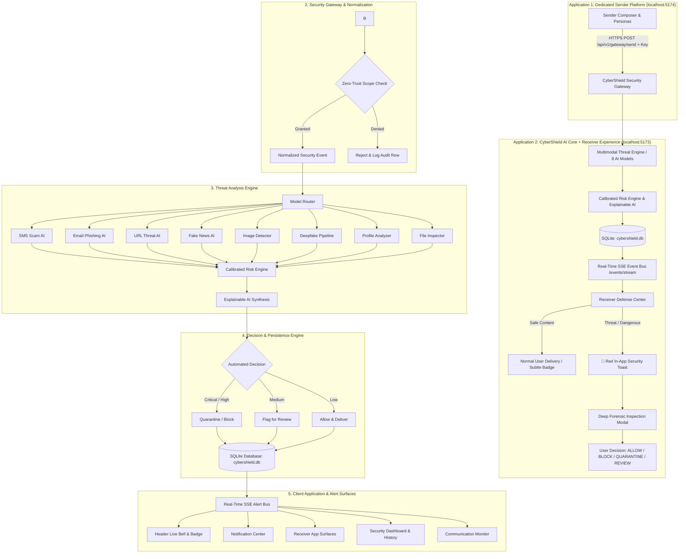

# CyberShield AI — Comprehensive System Architecture Document

```
================================================================================
CYBERSHIELD AI: Cross-Platform Multi-AI Cybersecurity Protection Ecosystem
Academic Security Testbed & Zero-Trust Defense Architecture
================================================================================
```

---

## 1. Executive Overview

**CyberShield AI** is an enterprise-grade academic cybersecurity ecosystem and multimodal threat intelligence engine. Built with **React 18 + TypeScript + Vite** on the frontend and **FastAPI + SQLite + SQLAlchemy** on the backend, CyberShield AI monitors incoming digital communications, normalizes heterogeneous events through zero-trust integration adapters, routes payloads across **8 specialized machine learning & heuristic detectors**, computes calibrated Explainable AI risk assessments, and issues real-time security alerts with full user agency (**BLOCK**, **QUARANTINE**, **REVIEW**, **ALLOW**).

---

## 2. End-to-End System Workflow



---

## 3. Core Architecture Subsystems

### 3.1 Three-Platform Decoupling
1. **Platform 1 — Sender Platform (`SenderPage.tsx`)**:
   - Academic security testbed providing 5 distinct sender personas (*Normal Colleague, Unknown Contact, Financial Institution, Fake Authority, Advanced Cyber Threat Persona*).
   - Generates test vectors across 8 modalities with pre-loaded safe and malicious attack vectors.
2. **Platform 2 — Receiver Platform (`ReceiverPage.tsx`)**:
   - Multi-app simulated reception surfaces (*SMS/Messages, Email Client, Social Media Feed, Web Browser, Media Gallery, Video Stream, Document Vault, System Alerts*).
   - Safe delivery for verified communications; sandboxed vault isolation for quarantined payloads.
3. **Platform 3 — CyberShield AI Defense Engine (`backend/app/`)**:
   - Central Event Processor managing the 6-stage lifecycle (`received` ➔ `normalized` ➔ `analyzed` ➔ `evaluated` ➔ `stored` ➔ `dispatched`).

---

### 3.2 Multimodal Threat Analysis Engine (`backend/app/services/threat_engine.py`)

CyberShield AI deploys 8 specialized detectors operating under a common abstract base class (`BaseThreatDetector`):

| Model Name | Content Modality | Feature Engineering & Architecture | Calibrated Threat Thresholds |
| :--- | :--- | :--- | :--- |
| **`sms_scam_detection_ai`** | Messages / SMS | TF-IDF tokenization, lottery/prize trap heuristics, urgency scoring | `SCORE >= 85 -> CRITICAL (QUARANTINE)` |
| **`email_phishing_classifier`** | Email | DKIM/SPF header checks, deceptive bank keyword matching, link extraction | `SCORE >= 80 -> CRITICAL (BLOCK)` |
| **`url_threat_evaluator`** | URLs / Links | Lexical entropy, raw IPv4 host detection, homograph lookups, TLD scoring | `SCORE >= 85 -> CRITICAL (QUARANTINE)` |
| **`fake_news_detector`** | Social / News | Sensation token density, unverified cure patterns, claim exaggeration | `SCORE >= 65 -> HIGH (REVIEW)` |
| **`image_manipulation_detector`** | Images | Error Level Analysis (ELA), perceptual hashing, GAN noise signatures | `SCORE >= 65 -> HIGH (REVIEW)` |
| **`deepfake_video_pipeline`** | Video Clips | Temporal facial consistency extractor, blink anomaly heuristics | `SCORE >= 80 -> CRITICAL (BLOCK)` |
| **`fake_profile_analyzer`** | User Profiles | Follower/following ratio asymmetry, account age, bio link risk | `SCORE >= 65 -> HIGH (REVIEW)` |
| **`file_security_checker`** | Files & Docs | Magic byte verification, AutoExec VBA macro heuristics, entropy analysis | `SCORE >= 80 -> CRITICAL (QUARANTINE)` |

---

### 3.3 Persistent Database Architecture (`backend/app/db/`)

The persistent storage tier is powered by SQLite via SQLAlchemy (`backend/data/cybershield.db`):

```
┌───────────────────────────────┐
│     SecurityEventModel        │
│ • event_id (Unique PK Index)  │
│ • modality, classification    │
│ • risk_score, risk_level      │
│ • ai_model, forensic_reasons  │
│ • final_action, user_action   │
│ • timestamps & audit metadata │
└──────────────┬────────────────┘
               │ 1-to-Many Cascading Relationships
       ┌───────┴───────┬────────────────────────┐
       ▼               ▼                        ▼
┌──────────────┐┌──────────────┐┌──────────────────────────────┐
│EventTimeline ││ EventAction  ││      NotificationModel       │
│ • step       ││ • action     ││ • notification_id            │
│ • status     ││ • prev_act   ││ • severity (CRITICAL/HIGH/..) │
│ • timestamp  ││ • actor      ││ • is_read, read_at           │
└──────────────┘└──────────────┘└──────────────────────────────┘
```

---

### 3.4 Zero-Trust Platform Integration & Permissions (`backend/app/integrations/`)

```
========================================================================
                      ZERO-TRUST SECURITY BOUNDARY
========================================================================
  [CyberShield Sandbox]                 [Third-Party Platforms]
           │                                      │
  • Pre-configured                       • WhatsApp, Instagram, Gmail
  • AUTHORIZED_SIMULATION                • NOT_CONNECTED by Default
  • 10/10 Local Scopes Granted           • Official OAuth2 / SDK Required
  • Zero OS/Sandbox Tampering            • Zero Password / Token Scraping
========================================================================
```

- **Permission Scopes (`PermissionScope`)**:
  - `READ_MESSAGES`, `READ_EMAIL`, `READ_URLS`, `READ_MEDIA`, `READ_PROFILES`, `READ_FILES`, `RECEIVE_EVENTS`, `ANALYZE_CONTENT`, `SEND_SIMULATION`, `MANAGE_SECURITY_ACTIONS`.
- **Normalization Pipeline**: All events must undergo `IntegrationRegistry.normalize_and_validate()` before entering the AI analysis pipeline. Events missing permissions are rejected with HTTP 403 and logged to `IntegrationAuditModel`.

---

### 3.5 Real-Time Notification & SSE Bus (`GET /api/v1/events/stream`)

- **Server-Sent Events (SSE)**: Streams security events directly to the browser with zero polling overhead.
- **Heartbeat & Auto-Reconnect**: Disconnect-safe design with exponential backoff and local SQLite cache fallback.
- **Header Indicator**: Dynamic notification bell badge (`🔔 3`) with critical threat highlighting (`badge-danger`).

---

## 4. Cross-Platform Responsive Viewport Engine

- **Windows Desktop Command Center**: High-density analytics, forensic investigation tables, filter chip toolbars, and multimodal inspection modals.
- **Android Mobile Simulated Viewport**: Native mobile container with bottom navigation bar, touch targets $\ge 48\text{px}$, slide-out drawer menu, and zero horizontal overflow.
- **Bi-Directional Theme System**: Dark Cybersecurity Slate mode and Enterprise Light mode with instant CSS token switching and local storage persistence.
